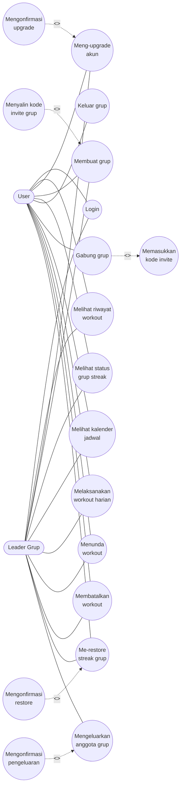

# Software Design Document (SDD) - StreakWok

## 1. Use Case Diagram

Diagram Use Case di bawah ini menggambarkan interaksi langsung antara pengguna dengan sistem aplikasi StreakWok.

---

## 2. Use Case Description

Berikut adalah 13 penjabaran tabel deskripsi dari masing-masing fungsi *Use Case* utama.

### UC-01 – Login
| Atribut | Keterangan |
| :--- | :--- |
| **Primary Actor** | User, Leader Grup |
| **Supporting Actor** | - |
| **Preconditions** | Pengguna belum masuk ke dalam sistem aplikasi. |
| **Postconditions** | Pengguna berhasil masuk ke halaman utama (*dashboard*). |

**Flow of Activities**
| Actor Input | System Response |
| :--- | :--- |
| 1. Pengguna membuka aplikasi dan menekan tombol *login*. | 1. Sistem menampilkan jendela pilihan akun Google. |
| 2. Pengguna memilih salah satu akun. | 2. Sistem memvalidasi akun ke *database*. |
| | 3. Sistem mengaktifkan sesi pengguna dan menampilkan *dashboard*. |

**Exception & Related Flow**
| Tipe | Keterangan |
| :--- | :--- |
| **Alternative Flow** | Pengguna menutup *pop-up* pemilihan akun: Sistem membatalkan *login* dan tetap di halaman awal. |
| **Exception Flow** | Koneksi gagal: Sistem menampilkan pesan *"Sistem gagal terhubung, periksa jaringan Anda"*. |
| **Related Use Case** | - |

***

### UC-02 – Melihat Riwayat Workout
| Atribut | Keterangan |
| :--- | :--- |
| **Primary Actor** | User, Leader Grup |
| **Supporting Actor** | - |
| **Preconditions** | Pengguna sudah masuk ke dalam sistem. |
| **Postconditions** | Data riwayat dan metrik olahraga tertampil di layar. |

**Flow of Activities**
| Actor Input | System Response |
| :--- | :--- |
| 1. Pengguna mengakses menu riwayat. | 1. Sistem menarik data total workouts dan total minutes dari database. |
| | 2. Sistem menampilkan angka dan riwayat pengguna. |

**Exception & Related Flow**
| Tipe | Keterangan |
| :--- | :--- |
| **Alternative Flow** | - |
| **Exception Flow** | Gagal memuat data: Sistem menampilkan data *cache* terakhir yang disimpan di memori HP. |
| **Related Use Case** | - |

***

### UC-03 – Meng-upgrade akun
| Atribut | Keterangan |
| :--- | :--- |
| **Primary Actor** | User, Leader Grup |
| **Supporting Actor** | - |
| **Preconditions** | Pengguna berstatus sebagai anggota *Free*. |
| **Postconditions** | Status pengguna menjadi *Pro* (kapasitas grup menjadi 10). |

**Flow of Activities**
| Actor Input | System Response |
| :--- | :--- |
| 1. Pengguna menekan tombol "Upgrade". | 1. Sistem menampilkan halaman paket berlangganan. |
| 2. Pengguna memilih paket. | 2. Sistem memicu *Extend: Mengonfirmasi upgrade*. |
| 3. Pengguna menyelesaikan proses konfirmasi. | 3. Sistem memperbarui atribut *Pro* di *database* dan menampilkan status berhasil. |

**Exception & Related Flow**
| Tipe | Keterangan |
| :--- | :--- |
| **Alternative Flow** | Pengguna membatalkan proses pembayaran, lalu sistem membatalkan transaksi dan kembali ke halaman pembayaran awal. |
| **Exception Flow** | Transaksi terputus, lalu sistem memunculkan pesan "Upgrade dibatalkan" |
| **Related Use Case** | Extend: Mengonfirmasi upgrade |

***

### UC-04 – Membuat grup
| Atribut | Keterangan |
| :--- | :--- |
| **Primary Actor** | User, Leader Grup |
| **Supporting Actor** | - |
| **Preconditions** | Pengguna tidak sedang terikat pada grup manapun. |
| **Postconditions** | Grup baru terbentuk. Pengguna otomatis menjadi *Leader Grup*. |

**Flow of Activities**
| Actor Input | System Response |
| :--- | :--- |
| 1. Pengguna menekan tombol "Buat Grup". | 1. Sistem memverifikasi status grup User. |
| 2. Pengguna mengisi nama grup dan menekan buat | 2. Sistem membuat grup baru dan meresmikan pengguna sebagai Leader. |
| | 3. Sistem menampilkan dashboard grup beserta kode invite. |

**Exception & Related Flow**
| Tipe | Keterangan |
| :--- | :--- |
| **Alternative Flow** | Pengguna menekan tombol salin, lalu sistem memicu <<extend>> Menyalin kode invite grup. |
| **Exception Flow** | Pengguna sudah memiliki grup aktif, lalu sistem memunculkan teks "Anda sudah memiliki grup workout" |
| **Related Use Case** | Extend: Menyalin kode invite grup |

***

### UC-05 – Melihat status grup streak
| Atribut | Keterangan |
| :--- | :--- |
| **Primary Actor** | User, Leader Grup |
| **Supporting Actor** | - |
| **Preconditions** | Pengguna sudah tergabung dalam sebuah grup aktif. |
| **Postconditions** | Layar menampilkan kondisi streak dan hitungan angka streak. |

**Flow of Activities**
| Actor Input | System Response |
| :--- | :--- |
| 1. Pengguna membuka halaman dashboard grup. | 1. Sistem memeriksa status penyelesaian olahraga seluruh anggota grup. |
| | 2. Sistem mengkalkulasi status dan menampilkan wujud ikon api streak hari ini. |

**Exception & Related Flow**
| Tipe | Keterangan |
| :--- | :--- |
| **Alternative Flow** | - |
| **Exception Flow** | - |
| **Related Use Case** | - |

***

### UC-06 – Keluar grup
| Atribut | Keterangan |
| :--- | :--- |
| **Primary Actor** | User |
| **Supporting Actor** | - |
| **Preconditions** | Aktor adalah member dari grup (bukan Leader) |
| **Postconditions** | Pengguna keluar dari grup dan mendapat cooldown 7 hari. |

**Flow of Activities**
| Actor Input | System Response |
| :--- | :--- |
| 1. Pengguna menekan tombol "keluar grup" | 1. Sistem menampilkan pop-up warning cooldown 7 hari. |
| 2. Pengguna menyetujui peringatan. | 2. Sistem menghapus akun User dari daftar anggota grup. |
| | 3. Sistem memberikan atribut cooldown selama 7 hari pada database pengguna. |

**Exception & Related Flow**
| Tipe | Keterangan |
| :--- | :--- |
| **Alternative Flow** | User menekan tombol "Batal" pada peringatan, lalu sistem menutup pop-up tanpa menghapus User. |
| **Exception Flow** | - |
| **Related Use Case** | - |

***

### UC-07 – Gabung grup
| Atribut | Keterangan |
| :--- | :--- |
| **Primary Actor** | User |
| **Supporting Actor** | - |
| **Preconditions** | Pengguna belum masuk grup manapun dan bebas dari masa *cooldown*. |
| **Postconditions** | Pengguna terdaftar sebagai anggota grup. |

**Flow of Activities**
| Actor Input | System Response |
| :--- | :--- |
| 1. Pengguna menekan tombol "Gabung Grup" | 1. Sistem memicu <<include>> memasukkan kode invite. |
| 2. Pengguna menyelesaikan proses memasukkan kode. | 2. Sistem memvalidasi kode dan ketersediaan slot grup. |
| | 3. Sistem menambahkan User ke dalam grup dan menampilkan dashboard grup. |

**Exception & Related Flow**
| Tipe | Keterangan |
| :--- | :--- |
| **Alternative Flow** | - |
| **Exception Flow** | Jika Kapasitas grup penuh, sistem menampilkan pesan "Grup sudah penuh". Jika User sedang cooldown, sistem menampilkan pesan "Anda belum bisa bergabung grup selama (sisa) hari" |
| **Related Use Case** | Include: Memasukkan kode invite |

***

### UC-08 – Melihat kalender jadwal
| Atribut | Keterangan |
| :--- | :--- |
| **Primary Actor** | User, Leader Grup |
| **Supporting Actor** | - |
| **Preconditions** | Pengguna sudah masuk ke dalam sebuah grup. |
| **Postconditions** | Kalender 30 hari termasuk siklus workout dan rest tertampil di layar. |

**Flow of Activities**
| Actor Input | System Response |
| :--- | :--- |
| 1. Pengguna membuka tab kalender workout. | 1. Sistem menghitung selisih hari ini dan tanggal awal grup dibentuk |
| | 2. Sistem merender 30 blok kalender dengan menandai blok hari ini. |

**Exception & Related Flow**
| Tipe | Keterangan |
| :--- | :--- |
| **Alternative Flow** | - |
| **Exception Flow** | - |
| **Related Use Case** | - |

***

### UC-09 – Melaksanakan Workout Harian
| Atribut | Keterangan |
| :--- | :--- |
| **Primary Actor** | User, Leader Grup |
| **Supporting Actor** | - |
| **Preconditions** | Hari ini adalah jadwal workout dan bukan rest day. |
| **Postconditions** | Repetisi dihitung dan status harian pengguna berubah menjadi tuntas. |

**Flow of Activities**
| Actor Input | System Response |
| :--- | :--- |
| 1. Pengguna menekan tombol mulai. | 1. Sistem menyalakan kamera depan dan memuat model AI. |
| 2. Pengguna mengeksekusi gerakan di depan kamera. | 2. Sistem merender visual titik sendi pada tubuh User, memvalidasi gerakan, dan menambah angka repetisi. |
| 3. Pengguna menekan selesai. | 3. Sistem mematikan kamera, menyimpan status tuntas, dan mengembalikan ke dashboard. |

**Exception & Related Flow**
| Tipe | Keterangan |
| :--- | :--- |
| **Alternative Flow** | - |
| **Exception Flow** | Kamera ditolak oleh OS, lalu sistem memblokir aksi dan menampilkan pesan "Izinkan akses kamera untuk memulai latihan." |
| **Related Use Case** | - |

***

### UC-10 – Menunda workout
| Atribut | Keterangan |
| :--- | :--- |
| **Primary Actor** | User, Leader Grup |
| **Supporting Actor** | - |
| **Preconditions** | Pengguna sedang berada dalam sesi workout. |
| **Postconditions** | Sesi dijeda sementara, hitungan repetisi tidak hilang. |

**Flow of Activities**
| Actor Input | System Response |
| :--- | :--- |
| 1. Pengguna menekan ikon "Pause". | 1. Sistem menghentikan sementara proses frame kamera pada AI. |
| 2. Pengguna menekan tombol "Lanjutkan" | 2. Sistem menampilkan overlay "Latihan dijeda" dan memunculkan tombol lanjutkan. |
| | 3. Sistem menyalakan kembali deteksi AI dan meneruskan hitungan repetisi sebelumnya. |

**Exception & Related Flow**
| Tipe | Keterangan |
| :--- | :--- |
| **Alternative Flow** | - |
| **Exception Flow** | - |
| **Related Use Case** | - |

***

### UC-11 – Membatalkan workout
| Atribut | Keterangan |
| :--- | :--- |
| **Primary Actor** | User, Leader Grup |
| **Supporting Actor** | - |
| **Preconditions** | Pengguna sedang berada dalam sesi workout aktif. |
| **Postconditions** | Sesi diakhiri paksa secara mendadak, status harian tetap belum tuntas. |

**Flow of Activities**
| Actor Input | System Response |
| :--- | :--- |
| 1. Pengguna menekan tombol batal. | 1. Sistem menghentikan total pemrosesan kamera. |
| | 2. Sistem menutup layar workout tanpa merubah status penyelesaian hari tersebut. |

**Exception & Related Flow**
| Tipe | Keterangan |
| :--- | :--- |
| **Alternative Flow** | - |
| **Exception Flow** | - |
| **Related Use Case** | - |

***

### UC-12 – Me-restore streak grup
| Atribut | Keterangan |
| :--- | :--- |
| **Primary Actor** | User, Leader Grup |
| **Supporting Actor** | - |
| **Preconditions** | Streak pada grup sedang dalam kondisi mati sementara. |
| **Postconditions** | Status streak kembali menyala, kuota restore bulanan berkurang 1. |

**Flow of Activities**
| Actor Input | System Response |
| :--- | :--- |
| 1. User menekan tombol restore/pulihkan. | 1. Sistem memverifikasi sisa kuota restore di database. |
| 2. Pengguna menyelesaikan konfirmasi pop-up. | 2. Sistem memicu <<extend>> mengonfirmasi restore. |
| | 3. Sistem menghidupkan kembali streak dan langsung memotong jatah pemulihan streak. |

**Exception & Related Flow**
| Tipe | Keterangan |
| :--- | :--- |
| **Alternative Flow** | Pengguna batal mengonfirmasi pop-up, lalu sistem menutup peringatan, dan kuota tidak jadi terpotong. |
| **Exception Flow** | Lewat batas jam 13.00 atau kuota kosong, sistem menolak dan menampilkan pesan waktu habis atau kuota restore tidak cukup. |
| **Related Use Case** | Extend: Mengonfirmasi restore. |

***

### UC-13 – Mengeluarkan anggota grup
| Atribut | Keterangan |
| :--- | :--- |
| **Primary Actor** | Leader Grup |
| **Supporting Actor** | - |
| **Preconditions** | User merupakan leader grup. |
| **Postconditions** | Anggota yang dipilih terhapus dari grup. |

**Flow of Activities**
| Actor Input | System Response |
| :--- | :--- |
| 1. Leader menekan tombol kick pada salah satu nama anggota. | 1. Sistem memicu <<extend>> mengonfirmasi pengeluaran. |
| 2. Leader menyetujui konfirmasi pengeluaran. | 2. Sistem menghapus baris data anggota grup tersebut dari struktur grup di database. |
| | 3. Sistem mengkalkulasi ulang status grup dengan menyalakan streak kembali jika sisa anggota sudah menuntaskan jadwal hari itu. |

**Exception & Related Flow**
| Tipe | Keterangan |
| :--- | :--- |
| **Alternative Flow** | Leader batal menyetujui konfirmasi, sistem menutup pop-up tanpa menghapus anggota grup. |
| **Exception Flow** | - |
| **Related Use Case** | Extend: Mengonfirmasi pengeluaran |
